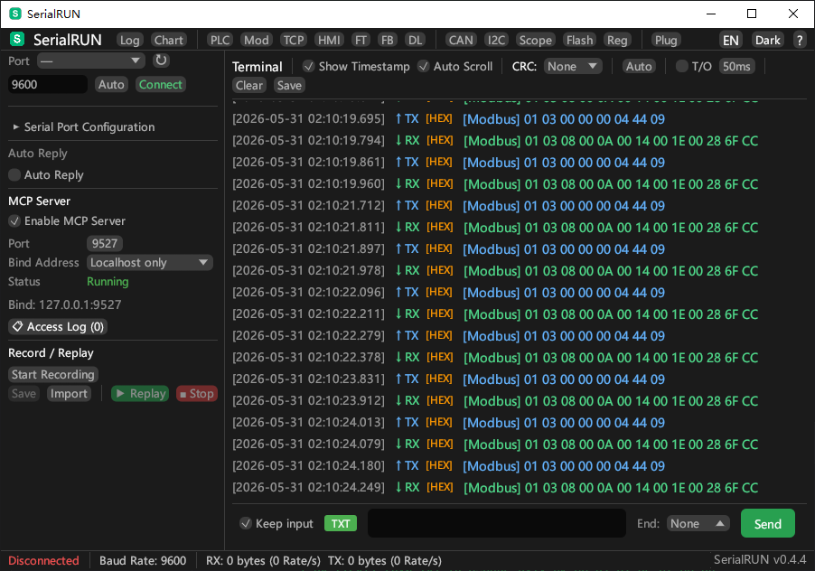
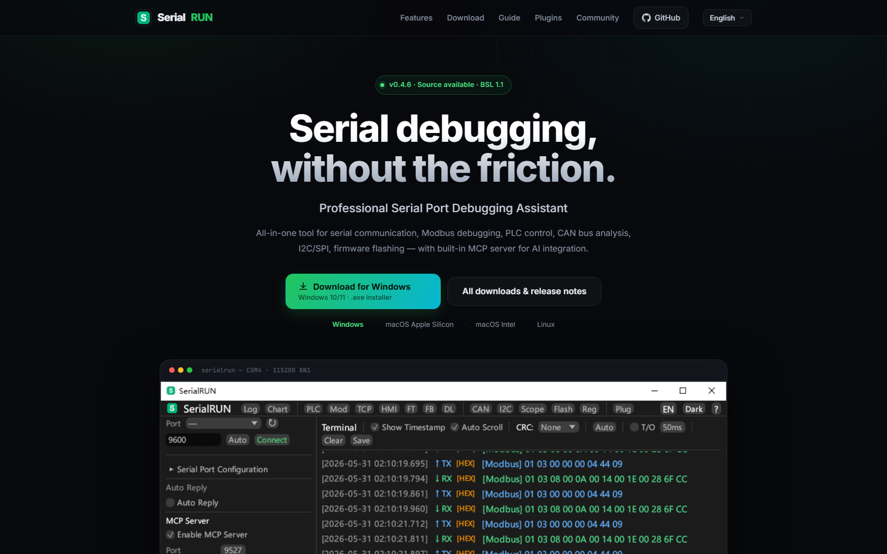

<div align="center">

# SerialRUN

**One serial tool for terminal work, Modbus/PLC debugging, CAN and I²C/SPI analysis,
firmware flashing — plus an MCP server that lets AI agents drive the port.**

[](https://github.com/YaoIsAI/SerialRUN/releases/latest)
[](https://github.com/YaoIsAI/SerialRUN/releases)
[](LICENSE)
[]()
[](https://www.rust-lang.org/)
[](https://github.com/YaoIsAI/SerialRUN/actions/workflows/ci.yml)
[](https://www.serialrun.com)

**English** | [简体中文](README_CN.md)

[Download](#download) · [Features](#features) · [MCP server](#mcp-server) · [Documentation](#documentation) · [Website](https://www.serialrun.com)

</div>

---

<p align="center">
  
</p>

<p align="center">
  <em>Modbus RTU debugging — live register monitoring with synchronized TX/RX in the terminal</em>
</p>

### Website

<p align="center">
  <a href="https://www.serialrun.com" target="_blank">
    
  </a>
</p>

<p align="center">
  <em><a href="https://www.serialrun.com" target="_blank">www.serialrun.com</a> — feature tour, OS-aware downloads, user guide, and documentation</em>
</p>

---

## Download

**Latest: v0.4.6** — [what's new](CHANGELOG.md) · [all releases](https://github.com/YaoIsAI/SerialRUN/releases)

| Platform | Recommended | Also available |
|----------|-------------|----------------|
| Windows (x64) | [serialrun-0.4.6-windows-x64-setup.exe](https://github.com/YaoIsAI/SerialRUN/releases/download/v0.4.6/serialrun-0.4.6-windows-x64-setup.exe) | [portable zip](https://github.com/YaoIsAI/SerialRUN/releases/download/v0.4.6/serialrun-0.4.6-windows-x64.zip) |
| macOS (Apple Silicon, M1–M4) | [serialrun-0.4.6-macos-arm64.dmg](https://github.com/YaoIsAI/SerialRUN/releases/download/v0.4.6/serialrun-0.4.6-macos-arm64.dmg) | [zip](https://github.com/YaoIsAI/SerialRUN/releases/download/v0.4.6/serialrun-0.4.6-macos-arm64.zip) |
| macOS (Intel) | [serialrun-0.4.6-macos-x64.dmg](https://github.com/YaoIsAI/SerialRUN/releases/download/v0.4.6/serialrun-0.4.6-macos-x64.dmg) | [zip](https://github.com/YaoIsAI/SerialRUN/releases/download/v0.4.6/serialrun-0.4.6-macos-x64.zip) |
| Linux (x86_64) | [serialrun_0.4.6_amd64.deb](https://github.com/YaoIsAI/SerialRUN/releases/download/v0.4.6/serialrun_0.4.6_amd64.deb) | [tar.gz](https://github.com/YaoIsAI/SerialRUN/releases/download/v0.4.6/serialrun-0.4.6-linux-x64.tar.gz) |

The website detects your OS and points the main button at the right installer:
[www.serialrun.com](https://www.serialrun.com/#download).

**Windows** — run the setup for Start Menu shortcuts and an uninstaller; the portable
ZIP needs no installation and also contains `serialrun-cli.exe` and `serialrun-mcp.exe`.

**macOS** — Apple Silicon (M1–M4) needs the arm64 build, Intel Macs need the x64 build.
The builds are ad-hoc signed (not notarized), so on first launch use
**right-click → Open**. If macOS reports the app as damaged, run
`xattr -dr com.apple.quarantine /Applications/SerialRUN.app` once and open it again.

**Linux** — `sudo apt install ./serialrun_0.4.6_amd64.deb` installs `serialrun`,
`serialrun-cli` and `serialrun-mcp` into `/usr/bin` and resolves dependencies.
For the tarball, extract and run `./serialrun`. Runtime dependencies (Ubuntu/Debian):
`sudo apt install libudev1 libxkbcommon0 libx11-6 libxcursor1 libxrandr2 libxi6 libgl1 libwayland-client0`

All packages are built automatically by GitHub Actions for every release — see
[the release workflow](.github/workflows/release.yml) and [docs/RELEASE_SOP.md](docs/RELEASE_SOP.md).

## Quick Start

### Connect your first device

1. Plug the USB serial device into your computer.
2. Launch SerialRUN and click **Refresh** next to the port selector.
3. Choose the port and baud rate, then click **Connect**.
4. Type in the input box and press **Send** (or Enter). Toggle **HEX**, **timestamp**,
   **CRC** or the line ending in the toolbar as needed.

Every panel is an independent OS window — open **Modbus**, **PLC**, **CAN**, **Scope**
or any other tool from the top bar and drag it anywhere, including onto a second monitor.

### Command line

The packages include `serialrun-cli` for scripted work:

```bash
# List available ports
serialrun-cli list

# Connect, send, and monitor
serialrun-cli send COM1 "Hello\r\n"
serialrun-cli monitor COM1 -t -l output.log

# Record and replay a session
serialrun-cli record COM1 -o script.txt
serialrun-cli replay COM1 script.txt
```

### Agent mode (JSON output for automation)

```bash
serialrun-cli agent list-ports                # List ports (JSON)
serialrun-cli agent COM1 send "AT+RST"        # Send data
serialrun-cli agent COM1 read --timeout 1000  # Read data
serialrun-cli agent COM1 run-script test.txt  # Run a script
```

## Why SerialRUN?

Serial debugging usually means juggling a terminal for raw I/O, another tool for
Modbus registers, a vendor utility for PLCs, and a separate viewer for CAN or
I²C/SPI traffic. SerialRUN puts them behind one multi-window UI and adds an MCP
server so AI assistants can operate the same port under your supervision.

| Capability | SerialRUN | PuTTY | Tera Term | VS Code Serial Monitor |
|------------|-----------|-------|-----------|------------------------|
| Native GUI on Windows, macOS and Linux | Yes | Windows only | Windows only | Yes |
| HEX view and timestamps | Yes | No | Partial | No |
| Modbus RTU/TCP monitor and frame builder | Yes | No | No | No |
| PLC presets, TCP↔RTU bridge, HMI simulator | Yes | No | No | No |
| CAN (SLCAN), I²C/SPI, oscilloscope | Yes | No | No | No |
| Script record and replay | Yes | No | Macro language | No |
| Built-in MCP server for AI agents | Yes (23 tools) | No | No | No |
| Multi-window panel layout | Yes | No | No | No |
| License | BSL 1.1 → MIT on 2030-05-31 | MIT | BSD-3-Clause | MIT |

Based on the default, publicly documented feature sets as of October 2026.

## Features

### Terminal and daily debugging
- **HEX or text** send/receive, optional timestamps, CRC selector, configurable line endings
- **Flexible baud rates** — arbitrary custom values plus presets up to 3,000,000
- **Auto-send and auto-reply** for repetitive test loops
- **Quick commands** for frequently used payloads
- **DTR/RTS control** for reset lines and boot modes
- **Auto-wrapping toolbar** — controls adapt to the window instead of being clipped
- **Keep-input mode**, auto-scroll, and a persistent terminal history

### Industrial protocols
- **Modbus RTU/TCP** monitoring with 8 function codes and a configurable response timeout (50–5000 ms)
- **Frame builder** — visual Modbus frame construction with live hex preview
- **PLC control** — register polling with brand presets (Siemens, Mitsubishi, Delta, Omron)
- **TCP/RTU bridge** — expose a serial Modbus device to Modbus TCP clients
- **HMI simulator** — virtual Modbus slave (TCP/RTU) with configurable registers and coils
- **Custom protocol patterns** for matching and decoding proprietary frames

### Analysis and visualization
- **Real-time charts** and communication statistics
- **Serial oscilloscope** with trigger and cursor measurement
- **CAN bus analyzer** — SLCAN parsing, ID filtering, per-ID statistics
- **I²C/SPI debug** — register read/write with configurable address and data width
- **Register editor** — CSV/JSON import/export with alarm-threshold monitoring
- **Data logger** — continuous CSV recording with timestamps
- **Packet capture viewer** — load and filter pcap files, per-packet inspection

### Firmware and file transfer
- **XMODEM / YMODEM / ZMODEM** transfers
- **STM32 ISP** serial flashing
- **ESP32** serial flashing

### Automation and AI integration
- **Script recording and playback** with timing preserved
- **CLI and agent mode** with JSON output for CI and tooling
- **MCP server** — 23 tools for AI assistants, with client-IP access logging
- **Auto-reply rules** for scripted device conversations

### Workflow and customization
- **Multi-window interface** — every panel runs as its own always-on-top OS window
- **Bilingual UI** (English/Chinese) with dark and light themes
- **Plugin system** — dynamic discovery, install, enable/disable and ZIP import
- **Data persistence** — configuration, logs, terminal history and warnings in `~/.serialrun/`
- **Global error system** — unified notifications in the status bar with history

## Requirements and permissions

| Platform | Requirement |
|----------|-------------|
| Windows | Windows 10/11 x64 |
| macOS | macOS 11 or newer; arm64 for Apple Silicon, x64 for Intel |
| Linux | x86_64 X11 or Wayland session |

- **USB serial drivers** — install the vendor driver if your adapter is not detected:
  CH340/CH341, CP210x, FTDI or PL2303. CDC-ACM devices work with the built-in driver.
- **Linux serial permissions** — add your user to the serial group, then log out and back in:
  `sudo usermod -aG dialout $USER` (`uucp` on Arch-based distributions).
- **Network** — the MCP server listens on `127.0.0.1:9527` by default and can be switched
  to LAN mode in the GUI; the port is configurable.
- **Building from source** — a current stable Rust toolchain; see [Development](#development).

## MCP Server

SerialRUN embeds an MCP server so AI assistants and scripts can inspect the port,
send commands and read Modbus registers through the same connection the GUI uses.
Enable it in the GUI sidebar (default `127.0.0.1:9527`); every call is written to the
access log with the client IP.

### Connect in 30 seconds

The server speaks JSON-RPC 2.0 over TCP:

```bash
printf '%s\n' \
  '{"jsonrpc":"2.0","id":1,"method":"initialize","params":{}}' \
  '{"jsonrpc":"2.0","id":2,"method":"tools/call","params":{"name":"list_ports","arguments":{}}}' \
  | nc 127.0.0.1 9527
```

From an MCP client, call tools such as `connect`, `send_command`, `modbus_read` or
`read`. A stdio bridge and Python/Node examples are in
[docs/MCP_API.md](docs/MCP_API.md).

### Available tools

| Tool | Description |
|------|-------------|
| `list_ports` | List all available serial ports |
| `connect` | Connect to serial port (baud rate, data bits, stop bits, parity, flow control) |
| `disconnect` | Disconnect from current connection |
| `send` | Send data (text or hex), no response wait |
| `read` | Read data from RX buffer (non-blocking, auto-captured by background monitor) |
| `send_command` | Send command and read response from buffer (recommended for AT commands) |
| `modbus_read` | Read Modbus RTU holding registers (with engineering value conversion) |
| `modbus_write` | Write Modbus RTU holding register |
| `plc_read` | Read all registers from a PLC preset brand |
| `plc_write` | Write to a PLC register by address |
| `status` | View connection status, byte counters, MCP server info |
| `get_device_info` | Port metadata (description, manufacturer, VID/PID) |
| `get_config` | Read UI settings (supports all or single key) |
| `set_config` | Update UI setting (syncs to GUI immediately) |
| `get_config_keys` | List all settable configuration keys |
| `clear_buffers` | Clear RX/TX buffers |
| `set_dtr` | Control the DTR line |
| `set_rts` | Control the RTS line |
| `get_access_log` | View access log with client IPs |
| `load_pcap` | Load a pcap capture file for analysis |
| `query_packets` | Query captured packets with filters |
| `get_packet` | Fetch a single captured packet |
| `pcap_stats` | Capture statistics and protocol summary |

All operations are logged with the client IP, multiple clients can connect
concurrently, and the access log is visible in the GUI settings panel.

## Troubleshooting

| Symptom | Fix |
|---------|-----|
| macOS says the app is damaged | `xattr -dr com.apple.quarantine /Applications/SerialRUN.app`, then open again |
| macOS app does not start on an Intel Mac | Use the **x64** DMG; the arm64 build only runs on Apple Silicon |
| Port is missing from the list | Install the USB-serial driver, use a data-capable cable, and close other programs holding the port |
| Permission denied opening the port on Linux | Add your user to `dialout` (`uucp` on Arch) and log in again |
| Custom baud rate is ignored | Fixed in v0.4.5 — update, then type the rate and press Enter or click **Connect** |
| MCP client cannot connect | Make sure MCP is enabled, nothing else uses port 9527, and firewall rules allow loopback |
| Linux app fails to start | Install the runtime dependencies listed in [Download](#download) |
| Need diagnostics | Check the in-app log viewer and `~/.serialrun/` (`logs.json`, `warnings.json`) |

If a problem persists, open an issue with your OS version, adapter model, and the
relevant log lines. Device dumps may contain sensitive payloads — redact them first.

## GUI Panels

All panels run as independent OS windows — drag, resize, and arrange freely. Child windows always stay on top of the main window.

| Panel | Description |
|-------|-------------|
| Terminal | Serial TX/RX with HEX mode, timestamps, CRC checksums, auto-wrapping toolbar |
| Modbus | RTU monitor with 8 function codes, configurable response timeout (50-5000ms), TX/RX in terminal |
| PLC Control | Register polling with brand presets (Siemens, Mitsubishi, Delta, Omron), TX in terminal |
| TCP/RTU Bridge | Bridge Modbus TCP clients to serial RTU devices |
| HMI Simulator | Virtual Modbus slave with configurable registers and coils |
| CAN Bus | SLCAN frame capture, ID filtering, per-ID statistics |
| I2C/SPI | Register read/write debug tool, TX in terminal |
| Oscilloscope | Real-time waveform display with trigger and cursor measurement |
| File Transfer | XMODEM / YMODEM / ZMODEM protocol transfer |
| Frame Builder | Visual Modbus frame construction with live hex preview |
| Flasher | STM32 ISP and ESP32 serial flashing |
| Data Logger | Continuous CSV recording with timestamp |
| Register Editor | CSV/JSON import/export, alarm threshold monitoring |
| Chart | Multi-series real-time data visualization |
| Plugin Manager | Dynamic plugin discovery and loading |
| Log Viewer | Application log with filter, export, and persistence |

## Project Structure

```
SerialRUN/
├── crates/
│   ├── serialrun-core/       # Core library (port, protocol, checksum, data logger)
│   ├── serialrun-cli/        # CLI application
│   ├── serialrun-gui/        # GUI application (egui/eframe)
│   ├── serialrun-mcp/        # MCP server for AI integration
│   ├── serialrun-mobile/     # Android USB serial adapter
│   ├── serialrun-mobile-app/ # Android app (eframe/egui)
│   └── serialrun-plugin-api/ # Plugin API definitions
├── plugins/
│   └── serialrun-example-plugin/  # Plugin example (C FFI)
├── assets/                   # Embedded images and icons
├── docs/                     # Documentation
├── tests/                    # Integration tests
└── benches/                  # Benchmarks
```

## Data Persistence

SerialRUN automatically saves data to `~/.serialrun/` directory:

| File | Content |
|------|---------|
| `config.toml` | Theme, language, baud rate settings |
| `logs.json` | Application logs (max 2000) |
| `terminal.json` | Terminal send/receive history (max 5000) |
| `warnings.json` | Warning/error history (max 1000) |
| `mcp_access_log.json` | MCP access log (max 1000) |

## Plugin Development

```rust
#[no_mangle]
pub extern "C" fn plugin_get_info() -> *mut c_char { /* ... */ }

#[no_mangle]
pub extern "C" fn plugin_execute(command: *const c_char, params: *const c_char) -> *mut c_char { /* ... */ }
```

See [plugins/serialrun-example-plugin/](plugins/serialrun-example-plugin/) for a complete example.

## Development

```bash
cargo build       # Build all crates
cargo test        # Run tests
cargo bench       # Run benchmarks
```

### Build from Source

```bash
git clone https://github.com/YaoIsAI/SerialRUN.git
cd SerialRUN
cargo build --release

# Windows:  target/release/serialrun.exe
# macOS:    target/release/serialrun
# Linux:    target/release/serialrun

# macOS .app bundle:
make app
```

| Platform | Target |
|----------|--------|
| Windows (MSVC) | `cargo build --target x86_64-pc-windows-msvc --release` |
| macOS (Apple Silicon) | `cargo build --target aarch64-apple-darwin --release` |
| macOS (Intel) | `cargo build --target x86_64-apple-darwin --release` |
| Linux | `cargo build --target x86_64-unknown-linux-gnu --release` |

See [docs/BUILD.md](docs/BUILD.md) for detailed platform-specific instructions.

## Documentation

| Document | Description |
|----------|-------------|
| [docs/help_en.md](docs/help_en.md) | English user guide |
| [docs/help_zh.md](docs/help_zh.md) | Chinese user guide |
| [docs/MANUAL.md](docs/MANUAL.md) | User manual |
| [docs/MANUAL_CN.md](docs/MANUAL_CN.md) | User manual (Chinese) |
| [docs/MCP_API.md](docs/MCP_API.md) | MCP API reference |
| [docs/BUILD.md](docs/BUILD.md) | Build guide |
| [docs/RELEASE_SOP.md](docs/RELEASE_SOP.md) | Release SOP (multi-platform CI) |
| [CHANGELOG.md](CHANGELOG.md) | Release history |
| [CLAUDE.md](CLAUDE.md) | Agent operation guide |

## Contributing

Contributions are welcome — bug reports, protocol corrections, translations and
pull requests all help.

- **Found a bug or have an idea?** Use the issue templates. Include OS, adapter
  model, and steps to reproduce; redact serial payloads that contain secrets.
- **Sending a PR?** Fork the repository, keep the change focused, and run
  `cargo fmt --all` and `cargo test --workspace` before opening it. CI builds on
  Windows, macOS and Linux.
- **Adding a plugin?** Start from `plugins/serialrun-example-plugin/` and see
  [docs/MCP_API.md](docs/MCP_API.md) for the tool surface.
- Read [CONTRIBUTING.md](CONTRIBUTING.md) for the full workflow.

## Roadmap

Planned work, subject to change — discuss priorities in
[Discussions](https://github.com/YaoIsAI/SerialRUN/discussions):

- Signed and notarized macOS builds (remove the Gatekeeper workaround)
- Community plugin search inside the Plugin Manager
- Broader PLC presets and Modbus function-code coverage
- Continued Android app parity with the desktop panels

## Community and Support

- [GitHub Discussions](https://github.com/YaoIsAI/SerialRUN/discussions) — questions, ideas and show-and-tell
- [GitHub Issues](https://github.com/YaoIsAI/SerialRUN/issues) — bug reports and feature requests
- [www.serialrun.com](https://www.serialrun.com) — guides, downloads and project news

If SerialRUN helps your work, consider giving the project a star — it helps other
embedded developers find it.

### Support the project

Donations help cover build machines, code-signing and hosting.

<p align="center">
  <a href="https://www.serialrun.com/#coffee" target="_blank">
    
  </a>
</p>

<p align="center">
  <em>WeChat Pay</em>
</p>

## License

SerialRUN is source-available under the [Business Source License 1.1](LICENSE), which
converts to the [MIT License](LICENSE) on **2030-05-31** or on the date the licensor
announces the change, whichever is earlier. Non-commercial use is unrestricted, and
businesses may use it for evaluation, internal testing and development. Commercial
use requires a separate license, and modified versions may not be distributed
without one; unmodified copies may be redistributed. See [LICENSE](LICENSE) for the
exact terms.

---

<div align="center">

**Made with ❤️ for embedded developers**

</div>
