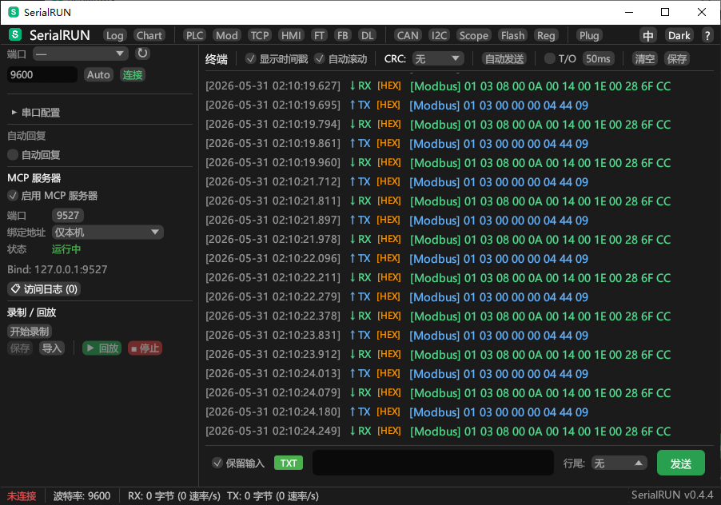

<div align="center">

# SerialRUN

**一站式串口调试工具：终端、Modbus/PLC 调试、CAN 与 I²C/SPI 分析、固件烧录，
外加让 AI 助手直接操作串口的 MCP 服务器。**

[](https://github.com/YaoIsAI/SerialRUN/releases/latest)
[](https://github.com/YaoIsAI/SerialRUN/releases)
[](LICENSE)
[]()
[](https://www.rust-lang.org/)
[](https://github.com/YaoIsAI/SerialRUN/actions/workflows/ci.yml)
[](https://www.serialrun.com)

[English](README.md) | **简体中文**

[下载](#下载) · [功能特性](#功能特性) · [MCP 服务器](#mcp-服务器) · [文档](#文档) · [官网](https://www.serialrun.com)

</div>

---

<p align="center">
  
</p>

<p align="center">
  <em>Modbus RTU 调试 — 实时寄存器监控，TX/RX 终端同步显示</em>
</p>

### 官网

<p align="center">
  <a href="https://www.serialrun.com" target="_blank">
    
  </a>
</p>

<p align="center">
  <em><a href="https://www.serialrun.com" target="_blank">www.serialrun.com</a> — 功能介绍、按系统自动匹配下载、使用指南和文档</em>
</p>

---

## 下载

**最新版本：v0.4.8** — [更新说明](CHANGELOG.md) · [全部版本](https://github.com/YaoIsAI/SerialRUN/releases)

| 平台 | 推荐安装包 | 其他格式 |
|------|-----------|----------|
| Windows (x64) | [serialrun-0.4.8-windows-x64-setup.exe](https://github.com/YaoIsAI/SerialRUN/releases/download/v0.4.8/serialrun-0.4.8-windows-x64-setup.exe) | [便携版 zip](https://github.com/YaoIsAI/SerialRUN/releases/download/v0.4.8/serialrun-0.4.8-windows-x64.zip) |
| macOS（Apple 芯片，M1–M4） | [serialrun-0.4.8-macos-arm64.dmg](https://github.com/YaoIsAI/SerialRUN/releases/download/v0.4.8/serialrun-0.4.8-macos-arm64.dmg) | [zip](https://github.com/YaoIsAI/SerialRUN/releases/download/v0.4.8/serialrun-0.4.8-macos-arm64.zip) |
| macOS（Intel 芯片） | [serialrun-0.4.8-macos-x64.dmg](https://github.com/YaoIsAI/SerialRUN/releases/download/v0.4.8/serialrun-0.4.8-macos-x64.dmg) | [zip](https://github.com/YaoIsAI/SerialRUN/releases/download/v0.4.8/serialrun-0.4.8-macos-x64.zip) |
| Linux (x86_64) | [serialrun_0.4.8_amd64.deb](https://github.com/YaoIsAI/SerialRUN/releases/download/v0.4.8/serialrun_0.4.8_amd64.deb) | [tar.gz](https://github.com/YaoIsAI/SerialRUN/releases/download/v0.4.8/serialrun-0.4.8-linux-x64.tar.gz) |

官网会根据你的操作系统自动匹配正确安装包：
[www.serialrun.com](https://www.serialrun.com/#download)。

**Windows** — 运行安装包可获得开始菜单快捷方式和卸载程序；便携版 zip 无需安装，
同时包含 `serialrun-cli.exe` 和 `serialrun-mcp.exe`。

**macOS** — Apple 芯片（M1–M4）请下载 arm64 版本，Intel 芯片请下载 x64 版本。
版本为 ad-hoc 签名（未公证），首次打开请**右键 → 打开**。如果提示“应用已损坏”，
执行一次 `xattr -dr com.apple.quarantine /Applications/SerialRUN.app` 后重新打开即可。

**Linux** — 执行 `sudo apt install ./serialrun_0.4.8_amd64.deb` 会把 `serialrun`、
`serialrun-cli`、`serialrun-mcp` 安装到 `/usr/bin` 并自动解析依赖。使用 tar.gz 时解压后
运行 `./serialrun`。运行依赖（Ubuntu/Debian）：
`sudo apt install libudev1 libxkbcommon0 libx11-6 libxcursor1 libxrandr2 libxi6 libgl1 libwayland-client0`

所有安装包均由 GitHub Actions 在每次发布时自动构建，参见
[发布流水线](.github/workflows/release.yml) 与 [docs/RELEASE_SOP.md](docs/RELEASE_SOP.md)。

## 快速开始

### 连接第一个设备

1. 通过 USB 连接串口设备。
2. 启动 SerialRUN，点击端口选择框旁的「刷新」。
3. 选择端口和波特率，点击「连接」。
4. 在输入框输入内容，点击「发送」或按回车。需要时可在工具栏切换 **HEX**、
   **时间戳**、**CRC** 和行尾设置。

所有面板都是独立的 OS 窗口——从顶栏打开 **Modbus**、**PLC**、**CAN**、**示波器**
等工具后，可以随意拖动，也可以放到第二块屏幕上。

### 命令行使用

安装包内附带 `serialrun-cli`，可用于脚本化操作：

```bash
# 列出可用串口
serialrun-cli list

# 发送数据、带时间戳监听
serialrun-cli send COM1 "Hello\r\n"
serialrun-cli monitor COM1 -t -l output.log

# 录制和回放脚本
serialrun-cli record COM1 -o script.txt
serialrun-cli replay COM1 script.txt
```

### Agent 模式（JSON 输出，适合自动化）

```bash
serialrun-cli agent list-ports                # 列出端口 (JSON)
serialrun-cli agent COM1 send "AT+RST"        # 发送数据
serialrun-cli agent COM1 read --timeout 1000  # 读取数据
serialrun-cli agent COM1 run-script test.txt  # 运行脚本
```

## 为什么选择 SerialRUN？

串口调试通常要同时开着终端、Modbus 工具、PLC 厂商软件，以及 CAN 或 I²C/SPI
分析工具。SerialRUN 用一个多窗口界面把它们整合在一起，并内置 MCP 服务器，
让 AI 助手可以在你的监督下操作同一个串口。

| 能力 | SerialRUN | PuTTY | Tera Term | VS Code Serial Monitor |
|------|-----------|-------|-----------|------------------------|
| Windows / macOS / Linux 原生界面 | 支持 | 仅 Windows | 仅 Windows | 支持 |
| HEX 显示与时间戳 | 支持 | 不支持 | 部分支持 | 不支持 |
| Modbus RTU/TCP 监听与帧生成 | 支持 | 不支持 | 不支持 | 不支持 |
| PLC 预设、TCP↔RTU 桥接、HMI 模拟 | 支持 | 不支持 | 不支持 | 不支持 |
| CAN (SLCAN)、I²C/SPI、示波器 | 支持 | 不支持 | 不支持 | 不支持 |
| 脚本录制与回放 | 支持 | 不支持 | 宏语言 | 不支持 |
| 内置 MCP 服务器（23 个工具） | 支持 | 不支持 | 不支持 | 不支持 |
| 多窗口面板布局 | 支持 | 不支持 | 不支持 | 不支持 |
| 许可证 | BSL 1.1 → 2030-05-31 转 MIT | MIT | BSD-3-Clause | MIT |

对照基于 2026 年 10 月各项目默认公开的功能特性。

## 功能特性

### 终端与日常调试
- **HEX / 文本**收发、可选时间戳、CRC 校验、自定义行尾
- **灵活波特率** — 支持任意自定义值，预设最高 3,000,000
- **自动发送与自动回复**，减少重复测试操作
- **快捷指令**，常用报文一键发送
- **DTR/RTS 控制**，方便复位和进入 Boot 模式
- **自动换行工具栏** — 控件随窗口大小自适应，不会被裁剪
- **保留输入、自动滚动**，终端历史持久化

### 工业协议
- **Modbus RTU/TCP** 监听，支持 8 种功能码，响应超时可配置（50–5000ms）
- **帧生成器** — 可视化构造 Modbus 帧，实时十六进制预览
- **PLC 控制** — 寄存器轮询，内置品牌预设（西门子、三菱、台达、欧姆龙）
- **TCP/RTU 桥接** — 把串口 Modbus 设备暴露给 Modbus TCP 客户端
- **HMI 模拟器** — 虚拟 Modbus 从站（TCP/RTU），可配置寄存器和线圈
- **自定义协议模式**，匹配和解析私有协议帧

### 分析与可视化
- **实时图表**和通信统计
- **串口示波器** — 实时波形，支持触发和光标测量
- **CAN 总线分析** — SLCAN 解析、ID 过滤、按 ID 统计
- **I²C/SPI 调试** — 寄存器读写，可配置地址和数据宽度
- **寄存器编辑器** — CSV/JSON 导入导出，报警阈值监控
- **数据记录器** — 持续 CSV 记录，带时间戳
- **抓包查看器** — 加载并过滤 pcap 文件，逐包分析

### 固件与文件传输
- **XMODEM / YMODEM / ZMODEM** 传输
- **STM32 ISP** 串口烧录
- **ESP32** 串口烧录

### 自动化与 AI 集成
- **脚本录制与回放**，保留时间间隔
- **CLI 与 Agent 模式**，JSON 输出便于 CI 和工具集成
- **MCP 服务器** — 23 个工具，支持 AI 助手并记录客户端 IP
- **自动回复规则**，实现脚本化的设备对话

### 工作流与个性化
- **多窗口界面** — 每个面板都是独立的置顶 OS 窗口
- **双语界面**（中文/英文），深色/浅色主题
- **内置升级** — 启动时检查 GitHub 新版本，展示更新说明，自动下载、SHA-256 校验、安装并重启
- **插件系统** — 动态发现、安装、启用/禁用和 ZIP 导入
- **数据持久化** — 配置、日志、终端历史、警告保存在 `~/.serialrun/`
- **全局错误系统** — 状态栏统一提示，支持历史查看

## 环境要求与权限

| 平台 | 要求 |
|------|------|
| Windows | Windows 10/11 x64 |
| macOS | macOS 11 或更新；Apple 芯片用 arm64，Intel 用 x64 |
| Linux | x86_64，X11 或 Wayland 会话 |

- **USB 串口驱动** — 如果适配器未被识别，请安装对应驱动：CH340/CH341、CP210x、
  FTDI 或 PL2303；CDC-ACM 设备使用系统内置驱动。
- **Linux 串口权限** — 将用户加入串口组，然后注销并重新登录：
  `sudo usermod -aG dialout $USER`（Arch 系发行版为 `uucp`）。
- **网络** — MCP 服务器默认监听 `127.0.0.1:9527`，可在 GUI 中切换为局域网模式，
  端口可修改。
- **从源码编译** — 需要较新的稳定版 Rust 工具链，参见[开发](#开发)。

## MCP 服务器

SerialRUN 内置 MCP 服务器，AI 助手和脚本可以通过它与 GUI 使用同一个串口连接，
查看端口状态、发送命令、读写 Modbus 寄存器。在 GUI 侧栏启用即可（默认
`127.0.0.1:9527`），每次调用都会带着客户端 IP 写入访问日志。

### 30 秒连接测试

服务器使用 JSON-RPC 2.0 over TCP：

```bash
printf '%s\n' \
  '{"jsonrpc":"2.0","id":1,"method":"initialize","params":{}}' \
  '{"jsonrpc":"2.0","id":2,"method":"tools/call","params":{"name":"list_ports","arguments":{}}}' \
  | nc 127.0.0.1 9527
```

在 MCP 客户端中可直接调用 `connect`、`send_command`、`modbus_read`、`read` 等工具。
stdio 桥接以及 Python/Node 示例见 [docs/MCP_API.md](docs/MCP_API.md)。

### 可用工具

| 工具 | 说明 |
|------|------|
| `list_ports` | 列出所有可用串口设备 |
| `connect` | 连接串口（支持波特率、数据位、停止位、校验位、流控） |
| `disconnect` | 断开当前连接 |
| `send` | 发送数据（支持文本和十六进制），不等待响应 |
| `read` | 从 RX 缓冲区读取数据（非阻塞，后台自动捕获） |
| `send_command` | 发送命令并从缓冲区读取响应（推荐用于 AT 命令） |
| `modbus_read` | 读取 Modbus RTU 保持寄存器（支持工程值转换） |
| `modbus_write` | 写入 Modbus RTU 保持寄存器 |
| `plc_read` | 读取 PLC 预设品牌的所有寄存器 |
| `plc_write` | 按地址写入 PLC 寄存器 |
| `status` | 查看连接状态、字节统计、MCP 服务器信息 |
| `get_device_info` | 查看串口设备信息（描述、厂商、VID/PID） |
| `get_config` | 读取 UI 设置（支持读取全部或单个键值） |
| `set_config` | 修改 UI 设置（立即同步到 GUI） |
| `get_config_keys` | 列出所有可配置项 |
| `clear_buffers` | 清空收发缓冲区 |
| `set_dtr` | 控制 DTR 信号线 |
| `set_rts` | 控制 RTS 信号线 |
| `get_access_log` | 查看访问日志（客户端 IP、操作记录、时间戳） |
| `load_pcap` | 加载 pcap 抓包文件进行分析 |
| `query_packets` | 按条件查询抓包数据包 |
| `get_packet` | 获取单个数据包详情 |
| `pcap_stats` | 抓包统计与协议汇总 |

所有操作自动记录客户端 IP，支持多客户端并发连接，访问日志可在 GUI 设置面板查看。

## 常见问题排查

| 现象 | 处理方法 |
|------|----------|
| macOS 提示应用已损坏 | 执行 `xattr -dr com.apple.quarantine /Applications/SerialRUN.app` 后重新打开 |
| Intel Mac 上应用无法启动 | 请下载 **x64** 版本；arm64 版本只能在 Apple 芯片上运行 |
| 端口列表中没有设备 | 安装 USB 串口驱动、换用支持数据传输的线缆，并关闭占用该端口的其他程序 |
| Linux 打开端口提示权限不足 | 将用户加入 `dialout`（Arch 为 `uucp`）并重新登录 |
| 自定义波特率不生效 | v0.4.5 已修复——升级后输入波特率并按回车或点击「连接」 |
| MCP 客户端连不上 | 确认已启用 MCP、9527 端口未被占用，且防火墙允许本机回环访问 |
| Linux 应用无法启动 | 安装[下载](#下载)章节列出的运行依赖 |
| 需要诊断信息 | 查看应用内日志和 `~/.serialrun/` 下的 `logs.json`、`warnings.json` |

如果问题仍然存在，请提交 Issue，并附上系统版本、适配器型号和相关日志。
设备报文可能包含敏感数据，请先脱敏。

## GUI 面板

所有面板作为独立 OS 窗口运行——自由拖拽、缩放和排列。子窗口始终在主窗口前面。

| 面板 | 说明 |
|------|------|
| 终端 | 串口收发，支持 HEX 模式、时间戳、CRC 校验，工具栏自动换行 |
| Modbus | RTU 监听，8 种功能码，可配置响应超时（50-5000ms），TX/RX 同步显示在终端 |
| PLC 控制 | 寄存器轮询，内置品牌预设（西门子、三菱、台达、欧姆龙），TX 同步显示在终端 |
| TCP/RTU 桥接 | 将 Modbus TCP 客户端桥接到串口 RTU 设备 |
| HMI 模拟器 | 虚拟 Modbus 从站，可配置寄存器和线圈 |
| CAN 总线 | SLCAN 帧捕获，ID 过滤，按 ID 统计 |
| I2C/SPI | 寄存器读写调试工具，TX 同步显示在终端 |
| 示波器 | 实时波形显示，支持触发和光标测量 |
| 文件传输 | XMODEM / YMODEM / ZMODEM 协议传输 |
| 帧生成器 | 可视化 Modbus 帧构造，实时十六进制预览 |
| 烧录器 | STM32 ISP 和 ESP32 串口烧录 |
| 数据记录器 | 持续 CSV 记录，带时间戳 |
| 寄存器编辑器 | CSV/JSON 导入导出，报警阈值监控 |
| 图表 | 多系列实时数据可视化 |
| 插件管理 | 动态插件发现和加载 |
| 日志查看 | 应用日志，支持过滤、导出和持久化 |

## 项目结构

```
SerialRUN/
├── crates/
│   ├── serialrun-core/       # 核心库（端口、协议、校验、数据记录）
│   ├── serialrun-cli/        # 命令行工具
│   ├── serialrun-gui/        # 桌面客户端 (egui/eframe)
│   ├── serialrun-mcp/        # MCP 服务器（AI 集成）
│   ├── serialrun-mobile/     # Android USB 串口适配层
│   ├── serialrun-mobile-app/ # Android 客户端 (eframe/egui)
│   └── serialrun-plugin-api/ # 插件 API 定义
├── plugins/
│   └── serialrun-example-plugin/  # 插件示例 (C FFI)
├── assets/                   # 嵌入式图片和图标
├── docs/                     # 文档
├── tests/                    # 集成测试
└── benches/                  # 性能测试
```

## 数据持久化

SerialRUN 自动保存以下数据到 `~/.serialrun/` 目录：

| 文件 | 内容 |
|------|------|
| `config.toml` | 主题、语言、波特率等配置 |
| `logs.json` | 日志记录（最多 2000 条） |
| `terminal.json` | 终端收发记录（最多 5000 条） |
| `warnings.json` | 警告/错误历史（最多 1000 条） |
| `mcp_access_log.json` | MCP 访问日志（最多 1000 条） |

## 插件开发

```rust
#[no_mangle]
pub extern "C" fn plugin_get_info() -> *mut c_char { /* ... */ }

#[no_mangle]
pub extern "C" fn plugin_execute(command: *const c_char, params: *const c_char) -> *mut c_char { /* ... */ }
```

完整示例见 [plugins/serialrun-example-plugin/](plugins/serialrun-example-plugin/)。

## 开发

```bash
cargo build       # 构建所有 crate
cargo test        # 运行测试
cargo bench       # 运行性能测试
```

### 从源码编译

```bash
git clone https://github.com/YaoIsAI/SerialRUN.git
cd SerialRUN
cargo build --release

# Windows:  target/release/serialrun.exe
# macOS:    target/release/serialrun
# Linux:    target/release/serialrun

# macOS .app 应用包：
make app
```

| 平台 | 目标 |
|------|------|
| Windows (MSVC) | `cargo build --target x86_64-pc-windows-msvc --release` |
| macOS (Apple Silicon) | `cargo build --target aarch64-apple-darwin --release` |
| macOS (Intel) | `cargo build --target x86_64-apple-darwin --release` |
| Linux | `cargo build --target x86_64-unknown-linux-gnu --release` |

详见 [docs/BUILD_CN.md](docs/BUILD_CN.md) 了解各平台构建详情。

## 文档

| 文档 | 说明 |
|------|------|
| [docs/help_en.md](docs/help_en.md) | 英文使用指南 |
| [docs/help_zh.md](docs/help_zh.md) | 中文使用指南 |
| [docs/MANUAL.md](docs/MANUAL.md) | 用户手册 |
| [docs/MANUAL_CN.md](docs/MANUAL_CN.md) | 用户手册（中文） |
| [docs/MCP_API.md](docs/MCP_API.md) | MCP API 参考 |
| [docs/BUILD_CN.md](docs/BUILD_CN.md) | 构建指南 |
| [docs/RELEASE_SOP.md](docs/RELEASE_SOP.md) | 发布 SOP（多平台 CI） |
| [CHANGELOG.md](CHANGELOG.md) | 版本更新记录 |
| [CLAUDE_CN.md](CLAUDE_CN.md) | Agent 操作指南 |

## 贡献指南

欢迎提交缺陷报告、协议修正、翻译和 Pull Request。

- **报告问题或建议** — 使用 Issue 模板，附上系统版本、适配器型号和复现步骤；
  串口报文中如含敏感信息请先脱敏。
- **提交 PR** — Fork 仓库，保持改动聚焦，并在提交前运行
  `cargo fmt --all` 和 `cargo test --workspace`；CI 会在 Windows、macOS 和 Linux 上构建。
- **开发插件** — 从 `plugins/serialrun-example-plugin/` 开始，工具接口参见
  [docs/MCP_API.md](docs/MCP_API.md)。
- 完整流程见 [CONTRIBUTING.md](CONTRIBUTING.md)。

## 路线图

以下为计划中的工作，可能调整；欢迎在
[Discussions](https://github.com/YaoIsAI/SerialRUN/discussions) 中讨论优先级：

- macOS 官方签名与公证（移除 Gatekeeper 变通步骤）
- 插件管理器中支持社区插件在线搜索
- 扩充 PLC 品牌预设与 Modbus 功能码覆盖
- Android 客户端持续对齐桌面端面板

## 社区与支持

- [GitHub Discussions](https://github.com/YaoIsAI/SerialRUN/discussions) — 提问、想法和作品分享
- [GitHub Issues](https://github.com/YaoIsAI/SerialRUN/issues) — 缺陷报告和功能请求
- [www.serialrun.com](https://www.serialrun.com) — 指南、下载和项目动态

如果 SerialRUN 对你的工作有帮助，欢迎给项目点一个 Star，让更多嵌入式开发者发现它。

### 支持项目

你的支持会用于构建机器、代码签名和网站托管等开销。

<p align="center">
  <a href="https://www.serialrun.com/#coffee" target="_blank">
    
  </a>
</p>

<p align="center">
  <em>微信支付</em>
</p>

## 许可证

SerialRUN 基于 [Business Source License 1.1](LICENSE) 源码开放发布：非商业用途不受限制，
企业可将其用于评估、内部测试和开发；商业用途需获得单独授权；未经授权不得分发修改版本，
可分发未修改的副本。许可证将于 **2030-05-31** 或版权方公告的更早日期转为
[MIT 许可证](LICENSE)。具体条款见 [LICENSE](LICENSE)。

---

<div align="center">

**为嵌入式开发者用心打造**

</div>
